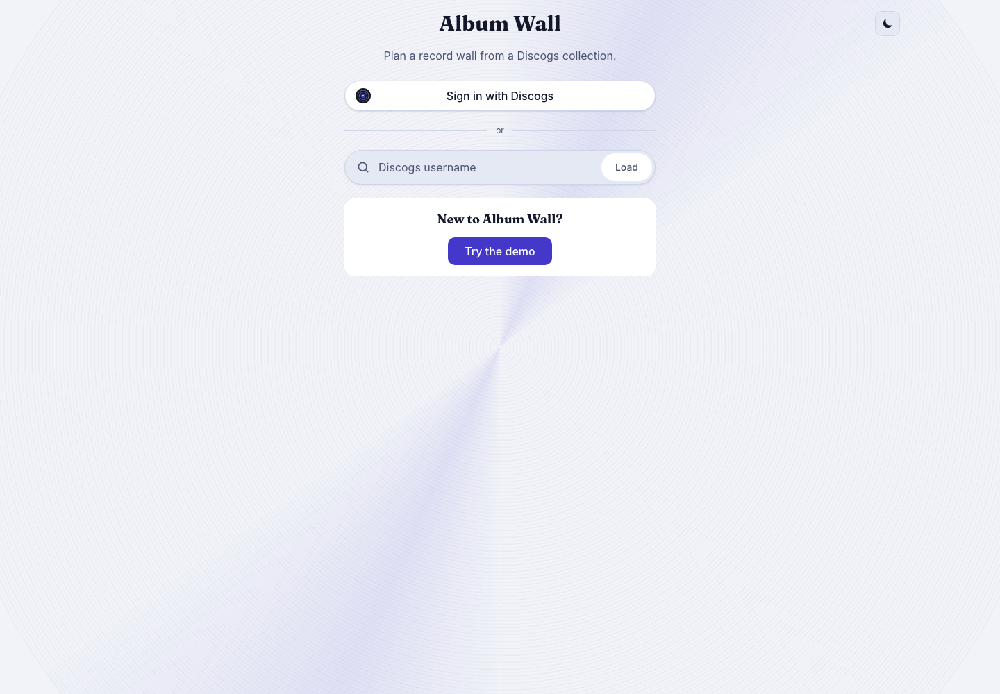
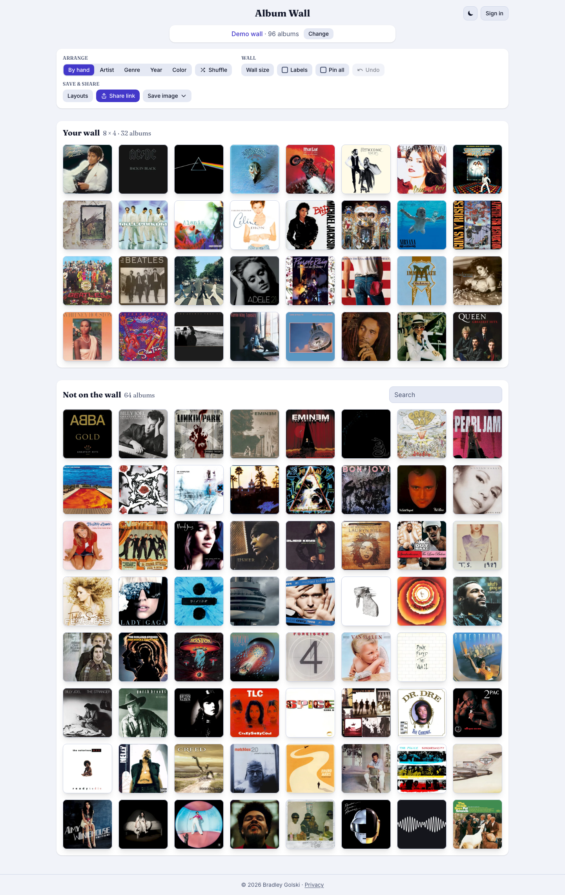
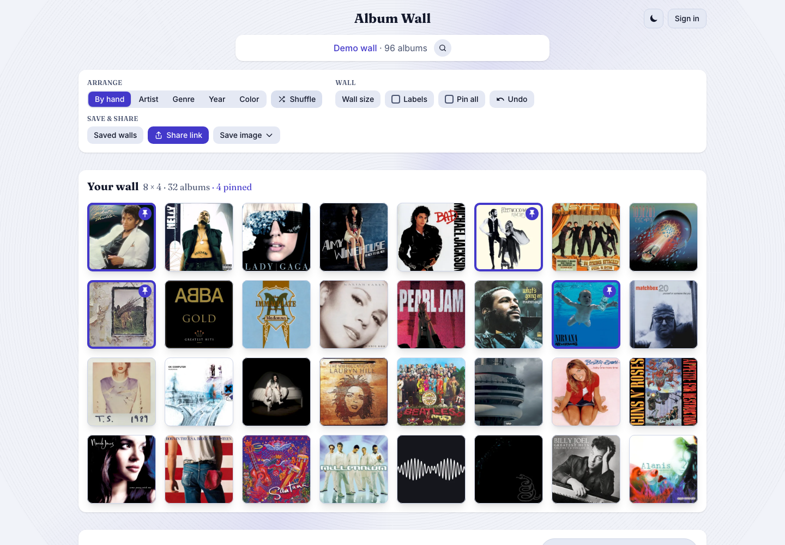
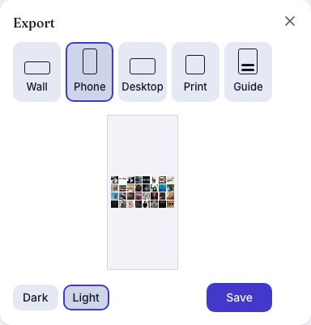
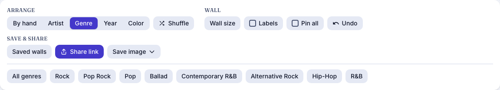
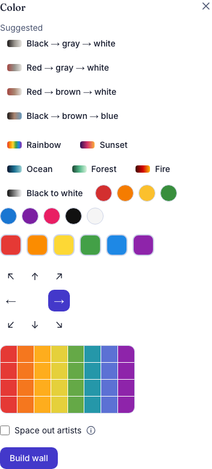
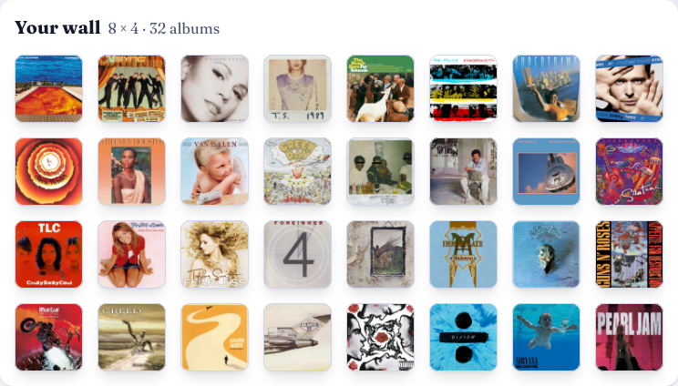
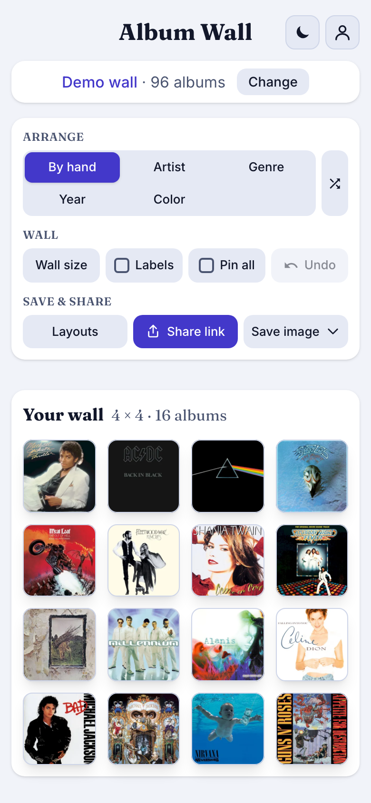

# Album Wall

Preview which records look good together on a wall before moving any of them. Album Wall lays a vinyl collection out as a grid of covers (8 × 4 by default), with the rest of the collection in a pool below. Drag records around, pin the ones you want to keep, build a wall by color, artist, genre or year, then save the result as an image or share a link.

**Live app:** [bradleygolski.com/album-wall](https://bradleygolski.com/album-wall/)

I collect vinyl and hang part of the collection on a wall, swapping records every so often like an art installation. I built Album Wall to see which covers look good, or clash, next to each other, and to plan a wall on screen before hanging anything. I wrote it mainly for myself and kept it usable by other collectors. It can load a public Discogs collection by username, your own private collection when you sign in with Discogs, or open a demo wall of 96 well-known albums with no account.

## What it does

- **Try it without an account.** First-time visitors see a small card offering a demo wall of 96 well-known albums, with covers loaded from the Cover Art Archive.
- **Load a Discogs collection** by username, or **sign in with Discogs** to load your own private collection, or one of its folders, in one tap. The sign-in key stays in your browser; the proxy passes it to Discogs and keeps nothing.
- **Rearrange by dragging** records between the wall and the pool, or tap a record to move or swap it.
- **Pin** records so that shuffling and swapping leave them in place. **Shuffle** only moves unpinned records, and **Undo** steps back.
- **Arrange** the wall from your whole collection in one tap: **Artist** sorts A to Z or builds a wall of one artist, **Genre** builds a wall of one genre or style (or runs through all of them), **Year** runs oldest to newest, newest first or one decade. Each is one reorder, so Undo puts the old wall back.
- **Build a wall from a gradient.** **Color** opens a simple gradient editor (two or three colors, presets, a direction) and suggests gradients your own collection can fill well. The wall is filled from your whole collection with the covers that best fit it and each other, judged by each cover's main colors and how its parts line up with the gradient, measured from tiny copies of the covers only when you ask. An optional switch keeps covers by the same artist from touching, and any color on a cover can start a wall of its own.
- **Search** the pool. **One copy per album** shows each album once when the collection holds several pressings of it; pressings are matched by their Discogs master release, so albums that merely share a title stay apart. Change the grid size, and show labels if you want them.
- **Remember what has been up.** Mark a saved wall as on your wall; the pool can then list records that have not been hung recently first, an album's details say when it was last up, and Build wall can avoid recent walls.
- **Save walls.** Name the wall and save it, use a saved wall to put it back, and rehang a saved wall at the real wall one step at a time: the cover to handle, the spot lit up on a small picture of the wall, and Done for the next. Saved walls are kept in your browser, or, when you are signed in, in your account so they load on any device (see [Privacy](https://bradleygolski.com/album-wall/privacy/)). A backup file moves them elsewhere.
- **Export the wall.** One panel offers the wall by itself, a phone or desktop wallpaper, a **poster** at print size (18 × 24 or 24 × 36 inches at 300 dots per inch, drawn by a service so a phone gets the same file as a computer), or a **hanging guide**: a PDF with the wall as a grid with its rows and columns numbered and every record listed with the row and column it hangs in, to take to the real wall. Wallpapers can have a dark or light background, or the app's turning record behind the wall, and a preview shows what will be saved. Or **share a link**: a short link opens the wall and shows a picture of it in message previews; if a short link cannot be made, a longer link that holds the wall in the part of the address after the `#` is copied instead.
- **Use the screen.** On a very wide screen the wall and the pool sit side by side, and a record turns slowly behind the page. A first visit opens with the record spinning up; people who prefer less motion get none of it, and phones see it once and then it fades away so scrolling stays smooth.
- **Keep working when a service is down.** Covers come from the app's own image service, then a public image proxy, then their own hosts; collections and cover colors fall back to loading directly if the cache or color service cannot be reached.

## Screenshots

Captured from the static build using `scripts/capture-case-study.ts` (the revision and route are recorded in [`docs/screenshots/capture.json`](docs/screenshots/capture.json)). The wall shows the demo collection.

|                                                                                                                                                                                                                |                                                                                                                                                                                                            |
| -------------------------------------------------------------------------------------------------------------------------------------------------------------------------------------------------------------- | ---------------------------------------------------------------------------------------------------------------------------------------------------------------------------------------------------------- |
|  |                                                |
| A fresh visit offers sign-in, a username, or the demo.                                                                                                                                                         | The demo's 8 × 4 wall with the record pool below it.                                                                                                                                                       |
|                                                   |                               |
| Four records pinned, then shuffled.                                                                                                                                                                            | Export: pick what to make, see it, save it.                                                                                                                                                                |
|          |  |
| Arrange by genre: one tap on a choice builds the wall.                                                                                                                                                         | Color: suggested gradients and the gradient editor.                                                                                                                                                        |
|                             |                                                                      |
| A rainbow wall built from the whole collection.                                                                                                                                                                | The same app on a phone.                                                                                                                                                                                   |

## How it is built

- **Frontend:** a Next.js, React and TypeScript app exported as static files and hosted on GitHub Pages. Tailwind CSS handles styling and [dnd-kit](https://dndkit.com/) the drag and drop; saved images are drawn on a canvas by the app itself. Everything that arranges a wall, including the color matching, runs in the visitor's browser (the gradient builder in a web worker).
- **Discogs proxy:** the browser cannot call the Discogs API with credentials, so a small AWS Lambda behind a Function URL fetches collections. The Discogs credentials live in AWS SSM Parameter Store and never reach the client. Signing in uses Discogs' OAuth 1.0a through the same proxy: the visitor's access token is kept in their browser and sent with their requests, and the proxy signs them with the app's consumer secret without storing anything ([details](infra/README.md#sign-in-with-discogs)). The proxy also stores signed-in visitors' saved layouts in DynamoDB and makes short share links. The stack is defined with the AWS CDK in [`infra/`](infra/README.md).
- **Collection cache:** a public collection is cached for five minutes by CloudFront, on the same domain as short links, keyed by username, so a second load does not page through Discogs again. Anything signed in goes straight to the proxy and is never cached.
- **Cover images:** Discogs serves covers without the CORS header a page needs to read their pixels, which saving an image and measuring colors both do. A Lambda (arm64, [sharp](https://sharp.pixelplumbing.com/)) fetches covers from Discogs and the Cover Art Archive only, and returns square WebP copies at 64, 320 or 600 pixels. It sits behind the CloudFront distribution at `/img`, which caches each copy for a year; only CloudFront may call it. Covers from other hosts go through the public [images.weserv.nl](https://images.weserv.nl/) proxy instead.
- **Cover colors:** each cover's colors (a palette and nine region colors) are measured in the browser, or, when a service is configured, asked for first from a small Lambda and DynamoDB table that keeps profiles measured by anyone, measuring a few missing ones itself with the same code. The browser measures only what it does not get back, and the main color is always chosen by the app's own rule.
- **Cost:** every AWS resource is defined in the CDK stack and sized for the always-free allowances: functions have a cap on concurrent runs, DynamoDB tables use provisioned capacity inside the free allowance, a $1 monthly budget emails an alert if anything is spent, and CloudWatch alarms watch each function's invocations, errors and throttles.
- **Offline:** a small service worker keeps the start page, the app's own files and the demo list, so the app opens again with no connection after one visit, and public collections fall back to their last copy when the network is slow or gone. Anything signed in is never kept.
- **Deployment:** every push to `main` runs a GitHub Actions workflow that deploys the CDK stack, builds the static site with the addresses it produces, checks the build output and publishes to GitHub Pages. AWS access uses GitHub OIDC, so there is no stored access key.
- **Demo data:** a JSON list of 96 albums in `public/demo/collection.json`, with each cover's colors already measured. Only the cover images load from outside the app, from the Cover Art Archive.
- **Cover loading:** a tile fetches its cover only once it is within about a screen of the viewport. Saving an image loads every cover first.

## Quality checks

Measured at revision `cb0fd41`:

- 790 unit and component tests in 103 files pass (`npm test`), as do type checking and linting. 72 browser tests pass (Playwright, against the static build), including accessibility checks with axe in light and dark mode. The infrastructure has 236 tests (`cd infra && npx jest`) and `npx cdk synth` succeeds.
- Lighthouse 12.6.1 (the repository's `lighthouserc.json`, the mobile profile with its default throttling), median of 5 runs against the static build served locally with gzip, as GitHub Pages serves it: performance 96, accessibility 100, best practices 100, SEO 100. First contentful paint 0.8 s, largest contentful paint 2.7 s, total blocking time 0 ms and layout shift 0. The page transferred 348 KB, of which 225 KB was JavaScript. The audit loads the page as a first-time visitor sees it, so no covers are part of it: the largest paint is the page's own text, which appears once the JavaScript has run. The pull request check requires performance of at least 90.

## Development

```bash
npm install

# Development server at http://localhost:3000
npm run dev
```

For a static build, set the proxy URL and base path. `npm run check:env` explains anything missing:

```bash
NEXT_PUBLIC_DISCOGS_PROXY_URL=https://your-function-url.example/ \
NEXT_PUBLIC_BASE_PATH=/album-wall \
npm run build:static

# Serve out/ under its base path at http://localhost:3100/album-wall/
NEXT_PUBLIC_BASE_PATH=/album-wall node scripts/serve-static.ts
```

Checks:

```bash
npm test               # unit tests
npm run type-check
npm run lint
npm run test:e2e       # Playwright + axe against the static build
npm run check:unused   # exports, files and dependencies nothing uses
npm run check:live     # the deployed site and its services, from outside (also runs weekly in GitHub Actions)
cd infra && npm ci && npx jest && npx cdk synth album-wall
```

To regenerate the screenshots, build and serve the static site as above, then run `node scripts/capture-case-study.ts` (`--og` makes only the link preview image, `public/og-image.jpg`; it uses Playwright's Chromium; install it with `npx playwright install chromium`).

### Environment variables

- `NEXT_PUBLIC_DISCOGS_PROXY_URL`: public HTTPS URL of the Discogs proxy. Never put Discogs credentials in a `NEXT_PUBLIC_*` variable.
- `NEXT_PUBLIC_BASE_PATH`: base path for GitHub Pages, such as `/album-wall` (set in CI).
- `NEXT_PUBLIC_IMAGE_SERVICE_URL` (optional): the cover image service; defaults to the app's own at `albumwall.bradleygolski.com/img`.
- `NEXT_PUBLIC_COLLECTION_CACHE_URL` (optional): where public collections are cached; unset, the proxy is called directly.
- `NEXT_PUBLIC_PROFILE_SERVICE_URL` (optional): the shared cover color service; unset, every cover is measured in the browser.
- `NEXT_STATIC_EXPORT`: `true` for a static export, `false` for server rendering (`npm run build:ssr`, `npm run start:next`).

## License

GPL-3.0. See [LICENSE](LICENSE).
