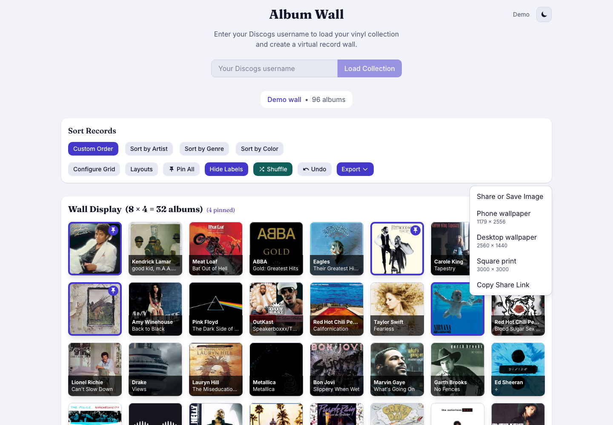
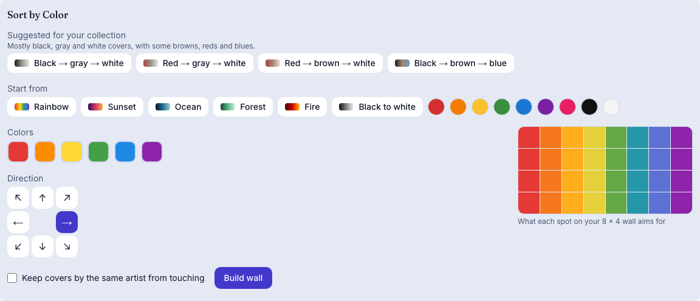
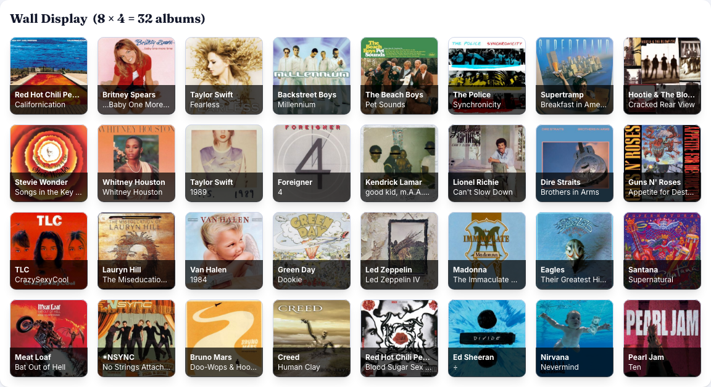

# Album Wall

Preview which records look good together on a wall before moving any of them. Album Wall lays a vinyl collection out as an 8 × 4 grid of covers, with the rest of the collection in a pool below. Drag records around, pin the ones you want to keep, shuffle the rest, then save the result as an image or copy a link to share it.

**Live app:** [bradleygolski.com/album-wall](https://bradleygolski.com/album-wall/)

I collect vinyl and hang part of the collection on a wall, swapping records every so often like an art installation. I built Album Wall to see which covers look good, or clash, next to each other, and to plan a wall on screen before hanging anything. I wrote it mainly for myself and kept it usable by other collectors. It can load a public Discogs collection by username, or open a demo wall of 96 well-known albums with no account.

## What it does

- **Try it without an account.** First-time visitors are offered a demo wall of 96 well-known albums, with covers loaded from the Cover Art Archive. The demo link stays in the header.
- **Load a Discogs collection** by username.
- **Rearrange by dragging** records between the wall and the pool, or tap a record to move or swap it.
- **Pin** records so that shuffling and swapping leave them in place. **Shuffle** only moves unpinned records, and **Undo** steps back.
- **Sort** by artist or genre, change the grid size, and hide the labels.
- **Build a wall from a gradient.** Sort by Color opens a simple gradient editor (two or three colors, presets, a direction) and suggests gradients your own collection can fill well. The wall is filled from your whole collection with the covers that best fit it and each other, judged by each cover's main colors and how its parts line up with the gradient, measured in your browser from tiny copies of the covers, only when you ask. An optional switch keeps covers by the same artist from touching, and any color on a cover can start a wall of its own.
- **Search** the pool, and optionally **show each album once** when the collection holds several pressings of one album.
- **Remember what has been up.** Mark the wall when you hang it; the pool can then list records that have not been hung recently first, an album's details say when it was last up, and Build wall can prefer rested records.
- **Keep layouts.** Save the wall under a name, put a saved wall back, and compare the wall with a saved one: a small diagram of the wall shows where each cover goes, with the steps in an order you can follow at the real wall. Layouts are kept in your browser; save a backup file to keep a copy or move them to another device.
- **Save the wall as an image** at a phone-wallpaper, desktop-wallpaper or square-print size, or copy a share link. The wall is remembered in the browser between visits.
- **Keep working when the image service is down.** Covers load from their own hosts instead, with a note saying so; covers whose host does not allow it are left out of saved images, and the message says how many.
- **Share a link.** A link to the app unfurls with a preview image. A link to a particular wall shows the same image, because the wall is stored in the part of the address after the `#`, which is never sent to a server; to share a specific wall as a picture, save it as an image.

## Screenshots

Captured from the static build using `scripts/capture-case-study.ts` (the revision and route are recorded in [`docs/screenshots/capture.json`](docs/screenshots/capture.json)). The wall shows the demo collection.

| | |
|---|---|
|  |  |
| A fresh visit offers the demo. | The demo's 8 × 4 wall with the record pool below it. |
|  |  |
| Four records pinned, then shuffled. | The Export menu with sized image options and a share link. |
|  |  |
| Sort by Color with suggestions for this collection. | A rainbow wall built from the whole collection. |

## How it is built

- **Frontend:** a Next.js, React and TypeScript app exported as static files and hosted on GitHub Pages. Tailwind CSS handles styling, [dnd-kit](https://dndkit.com/) the drag and drop, and html2canvas the image export.
- **Discogs proxy:** the browser cannot call the Discogs API with credentials, so a small AWS Lambda behind a Function URL fetches collections. The Discogs credentials live in AWS SSM Parameter Store and never reach the client. The Lambda runs with reserved concurrency of 5. The stack is defined with the AWS CDK in [`infra/`](infra/README.md).
- **Deployment:** every push to `main` runs a GitHub Actions workflow that deploys the CDK stack, builds the static site with the proxy URL it produces, checks the build output and publishes to GitHub Pages. AWS access uses GitHub OIDC, so there is no stored access key.
- **Demo data:** a JSON list of 96 albums in `public/demo/collection.json`. Only the cover images load from outside the app, from the Cover Art Archive.
- **Cover loading:** a tile fetches its cover only once it is within about a screen of the viewport. The browser's own lazy loading looks several screens ahead, which on a phone requested 82 of the demo's 96 covers before any scrolling; with this it requests 16. Saving an image loads every cover first.

## Quality checks

- 302 unit tests in 40 files pass (`npm test`), as do type checking and linting, and the 15 browser tests pass (`npm run test:a11y` runs the accessibility ones). Playwright and axe check accessibility in light and dark mode.
- Lighthouse 12.6.1 (the repository's `lighthouserc.json`, the mobile profile with its default throttling), median of 5 runs against the static build served locally with gzip, as GitHub Pages serves it, at revision `ba76966`: performance 96, accessibility 100, best practices 100, SEO 100. First contentful paint 0.8 s, largest contentful paint 2.7 s, total blocking time 0 ms and layout shift 0. The page transferred 283 KB, of which 181 KB was JavaScript. The same configuration run three times against the live site gave performance 98 to 99. The audit loads the page as a first-time visitor sees it, so no covers are part of it: the largest paint is the welcome dialog's text, which appears once the JavaScript has run. The pull request check requires performance of at least 90.

## Development

```bash
npm install

# Development server at http://localhost:3000
npm run dev
```

For a static build, set the proxy URL and base path. `npm run check:env` explains anything missing:

```bash
NEXT_PUBLIC_DISCOGS_PROXY_URL=https://your-function-url.example/ \
NEXT_PUBLIC_BASE_PATH=/album-wall \
npm run build:static

# Serve out/ under its base path at http://localhost:3100/album-wall/
NEXT_PUBLIC_BASE_PATH=/album-wall node scripts/serve-static.ts
```

Checks:

```bash
npm test               # unit tests
npm run type-check
npm run lint
npm run test:a11y      # Playwright + axe against the static build
```

To regenerate the screenshots, build and serve the static site as above, then run `node scripts/capture-case-study.ts` (`--og` makes only the link preview image, `public/og-image.jpg`; it uses Playwright's Chromium; install it with `npx playwright install chromium`).

### Environment variables

- `NEXT_PUBLIC_DISCOGS_PROXY_URL`: public HTTPS URL of the Discogs proxy. Never put Discogs credentials in a `NEXT_PUBLIC_*` variable.
- `NEXT_PUBLIC_BASE_PATH`: base path for GitHub Pages, such as `/album-wall` (set in CI).
- `NEXT_STATIC_EXPORT`: `true` for a static export, `false` for server rendering (`npm run build:ssr`, `npm run start:next`).

## License

GPL-3.0. See [LICENSE](LICENSE).
